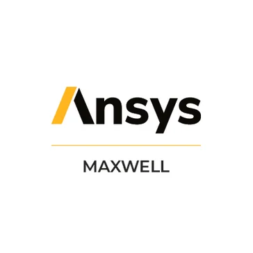
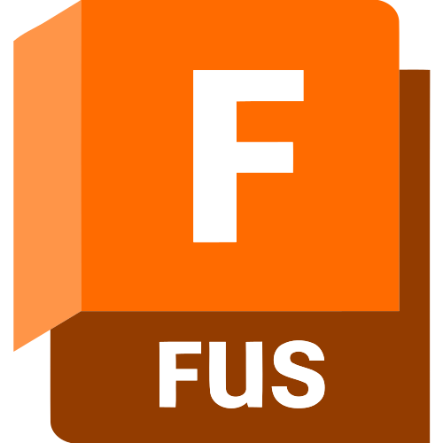

# Junzhe (Calvin) Yang

**Computer Science & Engineering @ UC Irvine**

 

---

## About

I build things where the software has to survive contact with real hardware — sensors that drift, timing that matters in milliseconds, and parts that have to physically line up.

The through-line is a two-stage electromagnetic accelerator I have been rebuilding since 2022, now on its third version. Getting it working meant learning electromagnetic simulation, CAD, fabrication, and embedded timing, because the problem needed all of them.

Most recently I wrote a physics simulator for it — a numerical model that helps explain *why* the hardware performs the way it does, and suggests that nearly half the muzzle velocity may be lost to suckback, an effect I couldn't see on the bench.

Outside engineering I run a gaming channel that has passed **50,000 subscribers** and **150M views**, which has taught me a lot about shipping on a schedule and iterating on real feedback.

---

## Featured work

| Project | What it is | |
|---|---|---|
| **Electromagnetic Accelerator** | Two-stage coil gun, ~11 m/s with a 54.64 g projectile. Coil timing derived from ANSYS Maxwell 2D, switched through optocouplers by an Arduino. | [Code](https://github.com/SomeHeresy/Electromagnetic-Accelerator) · [Case study](https://someheresy.github.io/projects/electromagnetic-accelerator.html) |
| **Coilgun Timing Simulator** | Python physics engine coupling capacitor discharge to projectile motion through position-dependent inductance. Custom RK4 solver, energy conserved to 6e-14, 22 tests in CI. Predicts a 46.8% velocity loss to suckback on my single-stage shot; the model over-predicts measured speed by ~45%, and I document where the gap comes from. | [Code](https://github.com/SomeHeresy/Coilgun-Simulator) · [Case study](https://someheresy.github.io/projects/coilgun-simulator.html) |
| **Arduino Sensor & Control System (EMCG Control)** | Arduino sensor monitor (ultrasonic + temperature/humidity) on an I²C OLED — an early experiment toward a future control display for the accelerator. | [Code](https://github.com/SomeHeresy/2026-summer-projects/tree/main/Arduino/Advanced) · [Case study](https://someheresy.github.io/projects/arduino-sensor-control.html) |
| **American Rocketry Challenge** | R&D and simulation lead for a seven-person team. Iterative OpenRocket analysis improved simulated flight accuracy by 23.2%; official score 139.8. | [Case study](https://someheresy.github.io/projects/american-rocketry-challenge.html) |
| **Portfolio site** | Built with AI (Claude) from my design direction and content. Static, no framework, no build step. | [Code](https://github.com/SomeHeresy/SomeHeresy.github.io) · [Live](https://someheresy.github.io/) |

---

## Currently building

- **Testing the simulator's prediction on real hardware** — the model predicts moving the projectile 12 mm further back could gain ~37% muzzle velocity, not yet tested
- **Coil gun V4 on STM32** — moving to interrupt-driven timing and closed-loop control, so stage 2 fires from *measured* projectile position instead of a fixed delay
- **Sharpening C and C++** ahead of embedded coursework
- Looking for **UCI project teams and undergraduate research** in embedded systems, power electronics, or robotics

---

## Toolbox

**Languages**

**Development**

**Engineering & design**

&nbsp;&nbsp;&nbsp;&nbsp;&nbsp;&nbsp;&nbsp;&nbsp;&nbsp;&nbsp;&nbsp;&nbsp;

---

## Goals for 2026

- Get coil gun V4 running closed-loop on STM32
- Join an engineering project team at UCI
- Land undergraduate research in embedded systems or power electronics
- Reach 100,000 subscribers

---

**Open to internships, research, and project teams** — embedded systems, electronics, firmware, simulation.

[someheresy.github.io](https://someheresy.github.io/) · [calviny7@uci.edu](mailto:calviny7@uci.edu)

