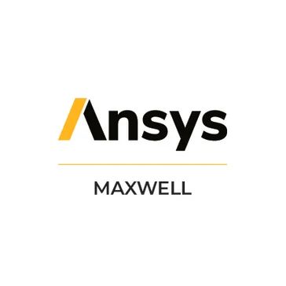
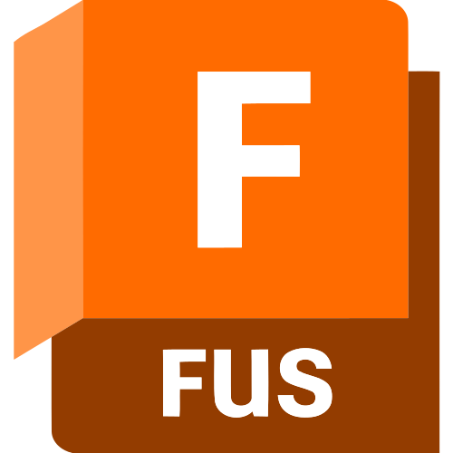

# Junzhe (Calvin) Yang

**Computer Science & Engineering @ UC Irvine**

 

---

## About me

- I build projects where software has to work on real hardware.
- My main project is a **two-stage coil gun** I have rebuilt three times since 2022.
- I wrote a **physics simulator** for it. It shows that almost half the speed may be lost to suckback.
- I also run a **gaming YouTube channel**: 50,000+ subscribers and 150M+ views.

---

## Projects

| Project | What it is | Links |
|---|---|---|
| **Electromagnetic Accelerator** | Two-stage coil gun. Fires a 54.64 g projectile at ~11 m/s. Timing comes from ANSYS Maxwell; an Arduino fires each stage. | [Code](https://github.com/SomeHeresy/Electromagnetic-Accelerator) · [Write-up](https://someheresy.github.io/projects/electromagnetic-accelerator.html) |
| **Coilgun Simulator** | Python model of one coil gun stage. Custom RK4 solver, energy conserved to 6e-14, 22 tests in CI. | [Code](https://github.com/SomeHeresy/Coilgun-Simulator) · [Write-up](https://someheresy.github.io/projects/coilgun-simulator.html) |
| **Arduino Sensor Display** | Arduino reads distance, temperature, and humidity and shows them on an OLED. A first step toward a coil gun control panel. | [Code](https://github.com/SomeHeresy/2026-summer-projects/tree/main/Arduino/Advanced) · [Write-up](https://someheresy.github.io/projects/arduino-sensor-control.html) |
| **American Rocketry Challenge** | R&D and simulation lead on a 7-person team. Improved simulated flight accuracy by 23.2%. Score: 139.8. | [Write-up](https://someheresy.github.io/projects/american-rocketry-challenge.html) |
| **Quant Research Framework** | Python backtesting framework with strict overfitting controls. Result: no tradable edge found. | [Code](https://github.com/SomeHeresy/shs-quant) |
| **Portfolio Site** | Static site. I made the design and content; Claude wrote the code. | [Code](https://github.com/SomeHeresy/SomeHeresy.github.io) · [Live](https://someheresy.github.io/) |

---

## Working on now

- **Testing the simulator on real hardware.** It predicts that starting the projectile 12 mm further back gives ~37% more speed.
- **Coil gun V4 on STM32.** Fire stage 2 from the projectile's measured position instead of a fixed delay.
- **Getting better at C and C++** for embedded coursework.
- **Looking for undergraduate research** in embedded systems, power electronics, or robotics.

---

## Tools

**Languages**

**Development**

**Engineering & design**

&nbsp;&nbsp;&nbsp;&nbsp;&nbsp;&nbsp;&nbsp;&nbsp;&nbsp;&nbsp;&nbsp;&nbsp;

---

## Goals for 2026

- Get coil gun V4 running closed-loop on STM32
- Join an engineering project team at UCI ✅
- Land undergraduate research in embedded systems or power electronics
- Reach 100,000 subscribers

---

**Open to internships, research, and project teams** in embedded systems, electronics, firmware, and simulation.

[someheresy.github.io](https://someheresy.github.io/) · [calviny7@uci.edu](mailto:calviny7@uci.edu)

